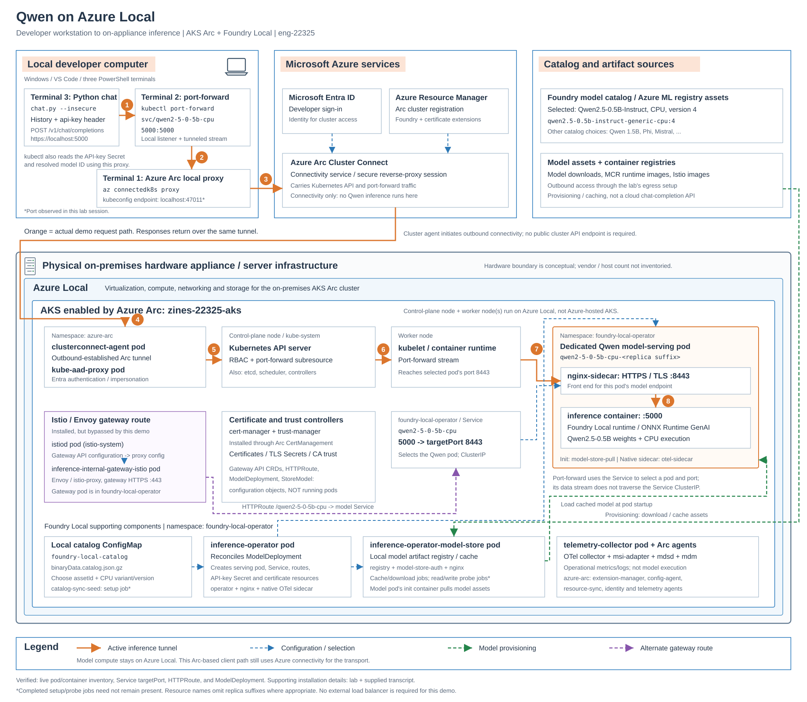

# Architecture: Qwen inference on Azure Local



[Open the scalable diagram](./architecture.svg) or [download the PNG](./architecture.png).
It uses the reference's white
background, outlined component groups, peach headings, numbered request steps,
and color-coded connectors. It is an editable SVG, not a screenshot.

## What actually happens in this demo

The three VS Code terminals run on the **developer's Windows computer**.
The Kubernetes cluster, supporting controllers, model store, and Qwen runtime
run on **Azure Local**, inside the on-premises hardware boundary.

| Step | Component | Action |
|---|---|---|
| 1 | Python `chat.py` | Sends `POST https://localhost:5000/v1/chat/completions`, an `api-key` header, and the conversation's messages. |
| 2 | `kubectl port-forward` | Accepts the local connection. It resolves `svc/qwen2-5-0-5b-cpu` to a pod and translates Service port `5000` to pod target port `8443`. |
| 3 | Local Azure Arc proxy | The kubeconfig points to this process (`localhost:47011` in the supplied session). It connects through Azure Arc Cluster Connect. |
| 4 | `clusterconnect-agent` | Maintains an outbound-established session from the cluster to Azure Arc. Cluster access does not require opening an inbound public Kubernetes API endpoint. |
| 5 | `kube-aad-proxy` and Kubernetes API server | Authenticate cluster access and authorize the Kubernetes operation. The API server carries the port-forward stream. |
| 6 | Worker kubelet / container runtime | Handles the port-forward stream to the selected pod. |
| 7 | Qwen pod's `nginx-sidecar` | Receives the model HTTPS connection on port `8443` and fronts the inference endpoint. |
| 8 | Qwen pod's `inference` container | Runs the Foundry Local CPU serving runtime (`onnx-genai`) with Qwen weights. The response returns through the same tunnel. |

**Important distinction:** port-forwarding to a Service uses it to select a pod
and target port. The forwarded bytes do **not** go through the Service ClusterIP.
The Kubernetes API server participates here because this is a development tunnel,
not the normal in-cluster inference route.

The Python script also uses kubectl to retrieve the API-key Secret and the
resolved model name. Those are Kubernetes API reads, separate from the model's
chat-completion API. Azure/Entra authorization for cluster access and the
per-model API key are different authentication layers.

The model endpoint uses TLS. The demo's `--insecure` option skips server
certificate verification; it does not switch the model request to plaintext.
Use it only for the trusted lab endpoint.

## Where Istio and Envoy fit

The installed deployment also has a gateway route:

```text
In-cluster caller
  -> inference-internal-gateway-istio:443
  -> HTTPRoute prefix /qwen2-5-0-5b-cpu (prefix rewritten to /)
  -> qwen2-5-0-5b-cpu Service:5000
  -> selected model pod:8443
  -> inference container:5000
```

For chat, the gateway request path is
`/qwen2-5-0-5b-cpu/v1/chat/completions`.
The diagram's purple route represents this alternative; **the current
`kubectl port-forward svc/qwen2-5-0-5b-cpu ...` demo bypasses the gateway**.
The gateway Service was observed as an internal ClusterIP, not a publicly
exposed endpoint.

- **Gateway API** defines configuration types such as `Gateway` and `HTTPRoute`.
  It is not the Kubernetes API server or a running proxy.
- **Istio's `istiod` pod** runs in `istio-system` and configures the gateway.
- **Envoy** runs in the `istio-proxy` container of the
  `inference-internal-gateway-istio-...` pod in `foundry-local-operator`.
  Its inspected image is `registry.istio.io/release/proxyv2:1.30.8`.
- The Qwen pod has an **NGINX** sidecar, not an observed Envoy sidecar.
  Installing Istio does not mean every pod is part of an injected service mesh.

## Model selection, download, and hosting

1. Browse the local `foundry-local-catalog` ConfigMap. In the supplied lab,
   catalog JSON was compressed in `binaryData.catalog.json.gz`.
2. Select a CPU model variant and use its **asset ID** in `ModelDeployment`.
   The installed operator requires `spec.model.assetId`, not the older
   `model.catalog` structure in the original walkthrough.
3. The operator reconciles the desired deployment, model-store resources,
   serving workload, Service, HTTPRoute, API-key Secret, and certificate resources.
4. The model-store/cache workflow makes model artifacts available locally.
   The serving pod has a `model-store-pull` init container that retrieves assets
   before inference starts.
5. A **separate model-serving pod**, not the operator pod, executes Qwen.
   The model weights and ONNX GenAI runtime are used inside its `inference`
   container; the weights are not themselves a separate pod.

| Setting | This scenario |
|---|---|
| Deployment | `qwen2-5-0-5b-cpu` |
| Namespace | `foundry-local-operator` |
| Model | `qwen2.5-0.5b-instruct-generic-cpu`, version `4` |
| Asset ID | `azureml://registries/azureml/models/qwen2.5-0.5b-instruct-generic-cpu/versions/4` |
| Runtime / compute | `onnx-genai` / CPU |
| Replicas | 1 |
| Requests / limits | 2 CPU / 6 GiB requested; 4 CPU / 10 GiB limits |
| Model file size | 861,939,957 bytes (about 0.80 GiB); not total runtime memory |
| API-key Secret name | `qwen2-5-0-5b-cpu-api-keys` (no key values shown) |

Other catalog entries discussed in the lab include Qwen 1.5B, Phi variants,
and Mistral. Availability and sizes depend on the catalog snapshot. Selecting a
catalog entry does not automatically deploy it.

## Supporting pods and services

| Component | Role |
|---|---|
| `inference-operator` | Controller plus NGINX and a native OTel sidecar; manages model deployments rather than executing model tokens. |
| `inference-operator-model-store` | Local artifact registry with `registry`, `model-store-auth`, and `nginx-sidecar` containers. Model storage is distinct from model execution. |
| `telemetry-collector` | OTel collector with native `msi-adapter`, `mdsd`, and `mdm` sidecars. Collects operational telemetry, not a hop in the inference response path. |
| `catalog-sync-seed` | Completed catalog setup job observed in the supplied transcript; not required to remain running. |
| Model-store auth probe jobs | Completed reader/writer checks in the supplied transcript and live inventory; not model servers. |
| `cert-manager` / `trust-manager` | Installed through the lab's `Microsoft.CertManagement` Arc extension for certificate lifecycle and trust distribution. Exact current pods/namespace were not confirmed by the live inspection. |
| Arc agents | Cluster connectivity, extension installation, configuration, identity, resource synchronization, and telemetry. They run in `azure-arc`. |
| Kubernetes infrastructure | API server, etcd, scheduler, controllers, kubelet/runtime, Cilium networking, DNS, and CSI storage support the workloads. |

Native sidecars can be declared under `initContainers` with
`restartPolicy: Always`. This explains why regular `spec.containers` alone
does not account for all containers in the transcript's `3/3` or `4/4` counts.
Readiness counts are **containers per pod**, not model replicas.

## Boundaries and evidence

- The hardware boundary is conceptual. No appliance vendor, physical host count,
  or exact physical topology was established.
- AKS Arc nodes run on Azure Local infrastructure; this is not Azure-hosted AKS.
  The transcript showed one control-plane node and one worker. The inspected
  application pods were on that worker; the diagram is logical, not a placement map.
- **Inference compute stays on Azure Local, but this access path uses Azure Arc
  cloud connectivity for the tunnel.** Do not interpret local execution as proof
  that request/response transport never leaves the site. Artifact downloads and
  configured telemetry are also distinct outbound flows.
- No Azure-hosted model inference API or external load balancer is used by this
  Python demo. The registry supplies assets, not chat responses.
- Pod/container names, Qwen init/native sidecars, Service port mappings,
  HTTPRoute, and resolved model settings were inspected live while preparing
  this diagram. Other setup context comes from the supplied transcript and lab.
  Controller reconciliation and cache flows are logical relationships, not a
  packet capture or a complete storage/network implementation inventory.

### References

- [Lab: install Foundry Local](https://docs.almr.adaptivecloudlab.com/eng-22325/foundry-local/deploy-foundry-local.html?tabs=powershell)
- [Lab: deploy a CPU model](https://docs.almr.adaptivecloudlab.com/eng-22325/foundry-local/deploy-model.html?tabs=powershell)
- [Lab: run inference](https://docs.almr.adaptivecloudlab.com/eng-22325/foundry-local/run-inference.html?tabs=powershell)
- [Microsoft Learn: Azure Arc Cluster Connect architecture](https://learn.microsoft.com/en-us/azure/azure-arc/kubernetes/conceptual-cluster-connect)
