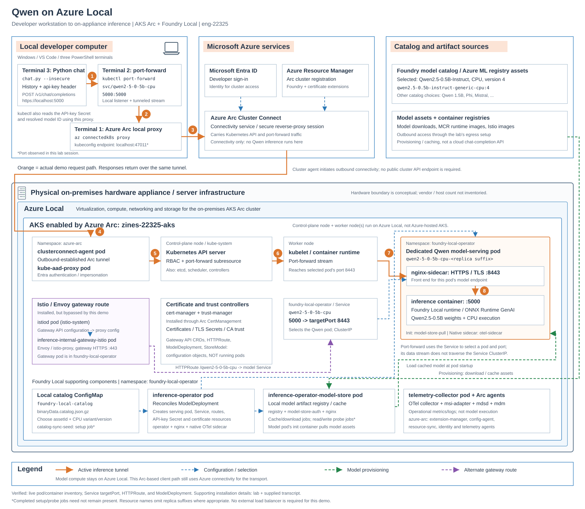

# Qwen conversational chat

The Python client uses only the standard library; no packages or virtual
environment are required. Python 3.9 or newer and `kubectl` must be on PATH.
The client uses your current kubectl context.

## PDF assistant application

### Domain scenario packages

Add a domain by supplying only its `scenario.json`, `system-prompt.md`, and PDF
documents. The shared RAG engine supports isolated indexes, prompts and history,
with a **Use case scenario** selector in the React UI. Content-only releases are
packaged and indexed on Azure Local without rebuilding images or replacing other
scenarios.

See [scenario authoring, packaging and publication](./docs/SCENARIOS.md) for the
workflow and included operations, manufacturing and retail examples. The
[core runbook](./docs/ASSISTANT.md) also explains how the original deployment was
created, what failed, and how it was validated.

The new React/FastAPI PDF assistant, local embedding service, Qdrant integration,
indexing pipeline, tests, and additive Kubernetes templates are documented in the
[assistant runbook](./docs/ASSISTANT.md). Container builds use **`az acr build`**,
not local Docker.

**Deployed on Azure Local:** the app, embeddings, Qdrant and document helper run
in `assistant-demo` on the added worker, with two Bound PVCs. The synthetic PDF
was indexed in-cluster, and the browser returned the correct recovery code with
a source passage. Images were built remotely in the explicitly approved external
ACR; lab-subscription ACR creation was blocked by RBAC/provider registration.

With the Arc proxy active, open the deployed UI through:

```powershell
kubectl --context zines-22325-aks port-forward -n assistant-demo svc/assistant-web --address 127.0.0.1 8080:80
```

Browse to `http://localhost:8080`. Pull credentials currently use an expiring
Entra token (about three hours); refresh them before later image pulls. The
runbook documents sign-in isolation, in-memory credential refresh, CoreDNS
configuration, indexing and the dedicated pull identity needed for production.

The header has a **Model** drop-down (shown when more than one model is
configured) next to the scenario picker. Choosing a model starts a fresh
conversation, each answer names the model that produced it, and the same
retrieved sources are used for either choice, so you can compare models on one
scenario. The port-forward must be running for the browser to reach the app;
stop it with Ctrl+C when finished.

Each answer displays input, output and total tokens reported by the model.
Input includes instructions, history and retrieved excerpts, not just your
question. Missing counts and responses requiring no model call are labeled
explicitly. These counts exclude embedding tokens and do not prove accuracy.

### Onboard a new scenario

The UI currently selects published scenarios; it does not provide a document
upload or scenario-creation screen. Use the publishing tool below to add one.

**Prerequisites:** run these commands from this project directory with the
assistant's existing `.venv` and dependencies installed (see the
[assistant setup](./docs/ASSISTANT.md)). Unlike the standard-library chat client,
the scenario tool requires those dependencies. You also need `kubectl` access to
the deployed assistant. Keep the [Arc proxy](#prerequisite-start-the-arc-proxy)
running in a separate terminal. Refresh expired image-pull credentials using the
[runbook](./docs/ASSISTANT.md) before publishing; the indexing Job needs to pull
the deployed application image.

#### 1. Create the scenario

Creation and packaging are local operations: Kubernetes connectivity is only
needed for Step 3 (upload and index). Create the folder first, add your documents
and edit the prompt, then package it.

The first argument is a stable **scenario ID**, not the display name. Use a
lowercase slug of at most 40 characters, starting with a letter, with letters,
digits and single hyphens between segments; spaces and uppercase letters are
invalid. `--name` is the human-readable display name and may contain spaces.
For example:

```powershell
.\.venv\Scripts\python.exe -m tools.scenario new contoso-field-service `
    --name "Contoso Field Service"
```

For the facilities example used throughout the remaining steps:

```powershell
.\.venv\Scripts\python.exe -m tools.scenario new facilities `
    --name "Facilities support"
if ($LASTEXITCODE -ne 0) { throw "Scenario creation failed." }
```

This generates:

```text
scenarios\facilities\
  scenario.json       Name, description and example questions
  system-prompt.md    Domain-specific instructions
  documents\          PDFs to index
```

Edit the generated definition to set the description and example questions.
Keep its stable `id` as `facilities`. Edit
the generated domain prompt, then copy your relevant PDFs into the generated
documents folder; nested folders are supported.

Word documents must first be exported to PDF, and scanned PDFs need OCR.
Provide at least one text PDF. Each package supports up to 200 PDFs, 25 MiB and
200 pages per PDF, and 48 MiB total compressed and expanded content. Do not commit
private documents or confidential prompt/definition content.

#### 2. Package the definition, prompt and documents

```powershell
$release = .\.venv\Scripts\python.exe -m tools.scenario package `
    .\scenarios\facilities | ConvertFrom-Json
if ($LASTEXITCODE -ne 0) { throw "Scenario packaging failed." }
$release.package
```

This creates a ZIP in the ignored local package directory. It is a content
release, not a container image; PDFs are not included in an ACR build.

#### 3. Upload and index in the existing cluster

```powershell
.\.venv\Scripts\python.exe -m tools.scenario deploy $release.package `
    --context zines-22325-aks --timeout 900
if ($LASTEXITCODE -ne 0) { throw "Scenario publication failed." }
```

The tool checks ownership, storage and capacity, uploads the package, and waits
for an indexing Job in `assistant-demo`. Parsing and embedding run on Azure Local.
The scenario ID automatically ties together its documents, isolated vector index,
system prompt and UI metadata. No manual database wiring, core image rebuild or
model redeployment is needed.

The upload travels through the connected Arc proxy; this is not a disconnected
or wholly on-premises transfer path. If publication fails, inspect the reported
error and follow the [recovery guide](./docs/SCENARIOS.md) before retrying.
Failed indexing preserves the previous searchable scenario.

#### 4. Select and test

Open `http://localhost:8080` using the application port-forward above. Click
**Refresh scenarios**, select **Facilities support** under **Use case scenario**,
and ask a question whose answer appears in your PDFs. Check the source passages.
Switching scenarios clears the displayed conversation.

**Update later:** edit the same scenario folder, then repeat packaging and
publication. Reusing the ID updates that scenario; a new ID adds another.
Each package is the complete document set, not an incremental upload: include
all PDFs you want searchable. Omitted documents leave that scenario's active
index after successful publication. Other scenarios remain unchanged.

All users who can reach this demo can select all published scenarios; the
selector is not an authorization boundary. See the
[full scenario guide](./docs/SCENARIOS.md) for validation limits and safe recovery.

## Architecture



See the [architecture walkthrough](./ARCHITECTURE.md) for the numbered request
path, important pods, model catalog and storage, and the distinction between the
active port-forward tunnel and the installed Istio/Envoy gateway route.
The diagram is available as [editable SVG](./architecture.svg) and [PNG](./architecture.png).

## Azure Local lab reference

This sample accompanies the **Azure Local Labs - AKS Arc with Foundry Local
(eng-22325)** lab:

[Run Inference | Azure Local Labs - AKS Arc with Foundry Local (eng-22325)](https://docs.almr.adaptivecloudlab.com/eng-22325/foundry-local/run-inference.html?tabs=powershell)

Use the lab guide and its preceding setup steps for the Azure Local, AKS Arc,
and Foundry Local prerequisites. Before running this Python demo, the Qwen model
deployment must be ready and its API key Secret available. The instructions below
cover connecting to that deployment and running the conversational client; they
do not replace the lab's infrastructure setup.

## Prerequisite: start the Arc proxy

Before running the demo, ensure Azure CLI is installed and signed in with access
to the Arc-enabled cluster. In the first PowerShell terminal, run:

```powershell
az connectedk8s proxy `
    --resource-group zines-22325-rg `
    --name zines-22325-aks
```

Wait until the command reports that the proxy is listening and that
`zines-22325-aks` is the current kubectl context. The proxy updates your kubeconfig
so subsequent kubectl commands can reach the cluster.

Leave this terminal running throughout the demo. Ctrl+C closes the proxy.

## Run

In a second PowerShell terminal, keep the port-forward running:

```powershell
kubectl port-forward svc/qwen2-5-0-5b-cpu -n foundry-local-operator 5000:5000
```

In a third terminal, from this folder:

```powershell
python .\chat.py --insecure
```

`--insecure` matches the `curl --insecure` in the original test. It disables
certificate verification: use it only with your trusted local port-forward.
Omit it if the endpoint has a certificate trusted by Python.

The script fetches the primary API key and resolved model name through kubectl.
It does not print or save the key. It sends each question with previous successful
user/assistant turns so you can ask follow-up questions.

- `/reset`: start a fresh conversation.
- `/history`: display saved user/assistant messages without calling the model.
- `/exit` or `/quit`: stop (Ctrl+C and end-of-input also stop).
- Failed turns are reported and not added to history; enter the question again
  to retry.

History lives only in memory and is lost on exit. Long conversations can exceed
the model's context limit; use `/reset` when needed. Responses are non-streaming,
so the assistant prints after the model finishes generating.

For slower CPU inference or longer responses:

```powershell
python .\chat.py --insecure --timeout 300 --max-tokens 512
```

`--timeout` sets the HTTP socket timeout in seconds (default: 180).
`--max-tokens` limits each response (default: 256), not the conversation length.
Use `python .\chat.py --help` for all options.

## Check conversation history

Keep the same Python process running for follow-up questions. Restarting the
script starts a new conversation; neither the client nor this API call saves a
conversation between runs.

To see the number and roles of messages sent with each request:

```powershell
python .\chat.py --insecure --debug
```

For example, enter these as two separate prompts at `You:`:

```text
My favorite fruit is mango. Remember this for my next question. Reply with OK.
What is my favorite fruit? Reply with only the fruit name.
```

The first request should show `Sending 2 messages: system, user`. The second
should show `Sending 4 messages: system, user, assistant, user`. Enter `/history`
to inspect the actual saved turns. Debug output does not print message content
or API keys; `/history` deliberately displays the conversation in your terminal.

If prior turns are present but the answer ignores them, that alone does not mean
the client dropped history. Model behavior and context limits can also affect
recall. The small 0.5B model may not reliably follow complex follow-up questions.

## Optional virtual environment

An environment is useful if you add dependencies later, but unnecessary now.
You can use one without activating it:

```powershell
python -m venv .venv
.\.venv\Scripts\python.exe .\chat.py --insecure
```

## Tests

Tests use mocks; they do not contact Kubernetes or the model or read real keys.

```powershell
python -B -m unittest -v test_chat
```

## Troubleshooting: Arc proxy cannot import `rpds.rpds`

If `az connectedk8s proxy` fails with `No module named 'rpds.rpds'` before
connecting, check `az --version` for the CLI's bundled Python version. A CLI
upgrade can leave an extension's compiled dependencies built for the previous
Python version. For example, an `rpds.cp313-win_amd64.pyd` file cannot load under
Python 3.14.

Reinstall the local extension to rebuild its dependency installation for the
current CLI interpreter:

```powershell
az extension remove --name connectedk8s
if ($LASTEXITCODE -ne 0) { throw "Could not remove connectedk8s." }

az extension add --name connectedk8s
if ($LASTEXITCODE -ne 0) { throw "Could not reinstall connectedk8s." }

az connectedk8s proxy --help
```

If the help command loads successfully, rerun the Arc proxy command above.
Reinstalling this extension does not remove the Arc registration or model
deployment. Installing `rpds-py` in the chat client's Python environment will not
repair Azure CLI: the CLI uses its own interpreter and extension dependencies.

The CLI can also load dependencies from another installed extension. If the next
traceback points into `cliextensions\aksarc` and reports a `pydantic_core` import
failure, reinstall that extension too:

```powershell
az extension remove --name aksarc
if ($LASTEXITCODE -ne 0) { throw "Could not remove aksarc." }

az extension add --name aksarc
if ($LASTEXITCODE -ne 0) { throw "Could not reinstall aksarc." }

az connectedk8s proxy --help
```

Use the extension directory named in the traceback to identify the conflicting
installation. Do not rename or copy compiled `.pyd` files between Python versions.
